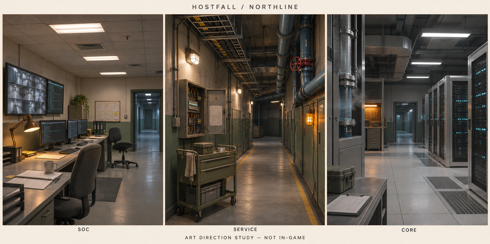

# HOSTFALL: бесплатные модели и обстановка технохоррора

Дата проверки: 2026-11-07. Исследование и художественное предложение, не отчёт о
перестройке уровня. Текущая Unity-сцена и приложение в этой итерации не изменялись.

## Рекомендация

NORTHLINE должен сначала выглядеть как место, в котором люди могли работать.
Светлые панели, крашеные инженерные шкафы, рабочие столы, проводка с понятным
маршрутом, следы обслуживания. Тревога возникает, когда игрок понимает нормальное
устройство комплекса и замечает конкретное нарушение: незакрытая смена, повторяющийся
обход, живой процесс на оставленном посту, техника, продолжающая ненужную работу.

Предлагаемое направление — современный инженерный комплекс после внезапной эвакуации.
Геометрия сдержанная, поверхности среднего и светлого тона, тёмными остаются
вставки оборудования, резина и локальные непросматриваемые участки. Неон используется
на оборудовании и в навигации. У комнат разная световая и материальная идентичность.

**Основной набор:** собственная простая архитектура + выбранные детали существующего
Quaternius Standard + несколько согласованных PBR-предметов Poly Haven.
Мебель/стойки/пульты с уникальным взаимодействием требуют собственной доработки.
Единого бесплатного набора, одновременно закрывающего архитектуру, современную мебель,
терминалы, персонажа и законченный хоррор, в проверенной подборке не найдено.

Изображение создано встроенным image_gen по [сохранённому промпту](concept-prompt.txt).
Это оригинальный концепт: не screenshot Unity, не точная раскладка бесплатных моделей,
не обещание такого качества без дальнейшей работы. Представляет целевое сочетание света,
материалов и плотности обстановки. В частности, конфигурация проходов и расстановка стоек
на эскизе не заменяет игровой план. Названия SOC / SERVICE / CORE — существующие зоны.

## Что исследовано и насколько проверено

- 24 конкретные позиции: 21 модель/набор и 3 материала. Ссылки и решения ниже.
- Для 8 моделей получены официальные glTF-описания и манифесты файлов. Подсчитаны
  треугольники из index accessors, meshes, материалы и заявленный объём комплекта 1K.
  Результаты и SHA256 glTF: [measured-models.json](measured-models.json).
- Просмотрены исходные превью стола, труб, тележки; оценены назначение и сочетаемость.
- Проинвентаризирован уже скачанный Standard ZIP Quaternius: по 189 FBX в каталогах
  FBX и FBX (Unity), 191 OBJ и 191 glTF. Форматы не суммируются как уникальные модели.
  В активный проект по-прежнему импортированы прежние 16 выбранных моделей.
- У остальных кандидатов проверена первичная страница автора/магазина. Это не проверка
  всех мешей, UV, коллизий или импорта в Unity 6000.6.8f1. Совместимость, заявленная
  магазином для другой версии Unity, не равна нашему успешному запуску.
- Не устанавливались скрипты из пакетов, не принимались новые EULA, не импортировались
  новые сторонние assets. Превью сайтов не скопированы в публичные документы.

## Почему текущая сцена выглядит чёрной и сырой

Проверка локального кода, а не предположение о качестве скачанного набора:

1. `Editor/ModularKit.cs`, метод Material: общий tint (.65, .72, .76), для материалов
   с Dark дополнительно `color *= .5f`. Текстура умножается на этот цвет; часть
   поверхности темнеет ещё до освещения.
2. `Editor/FacilityBuilder.cs`, CreateMaterials: Dark Metal (.055,.075,.09),
   Floor Panels (.14,.18,.21), Concrete (.25,.28,.29). Почти всё в одном холодном
   диапазоне. Серверная и операторская используют общий метод Room и одинаковую
   схему потолочного света. Мало различий между зонами.
3. Крупные поверхности часто получают metallic .35–.65, включая общий материал
   столов/облицовки. Для целиком окрашенной поверхности нужен материал краски;
   открытый металл отделяется маской. Блеск на почти чёрном фоне теряет читаемость.
4. Builder не создаёт ReflectionProbe/LightProbeGroup и не выполняет bake освещения.
   Это не доказательство отсутствия любых reflection settings в проекте, но явная
   недостающая часть авторского процесса. Увеличение количества эмиссивных полос её
   не заменяет.
5. Геометрия повторяется без достаточной иерархии: мало больших спокойных плоскостей,
   средних функциональных узлов и небольших личных предметов, объясняющих масштаб.

Вывод: сначала нужны читаемые материалы, свет и композиция. Дополнительные ящики
не исправят эти причины. Отдельные яркие поверхности дадут больший эффект, чем
равномерное повышение экспозиции всей чёрной комнаты.

## Три возможных направления

Оценки ниже — художественное суждение для HOSTFALL, не свойства лицензии или результаты
производительности. 5 означает лучшее соответствие задаче.

| Направление | Как выглядит | Соответствие канону | Что потребует | Решение |
| --- | --- | --- | --- | --- |
| Инженерный комплекс | Молочный, шалфейный, бетон, анодированный металл; современная техника, локальный янтарный свет | 5/5 | Авторская оболочка, несколько PBR-предметов, настройка материалов и света | Основной вариант |
| Ретрофутуризм | Кремовые корпуса, оливковая техника, аналоговые приборы, сильнее выраженная эпоха | 4/5 | Доработка интерфейсов/корпусов, единое объяснение возраста оборудования | Использовать в старых сервисных узлах, не превращать весь комплекс в 1979 год |
| Модульная sci-fi-станция | Рёбра, панели, шлюзы, насыщенные эмиссивные вставки | 3/5 | Быстрее собрать shell; сложнее избежать типового космического коридора | Оставить отдельные инженерные детали, а не весь интерьер |

## Наборы: что брать и что отложить

Все сведения о бесплатности относятся к дате проверки. Лицензия конкретного архива
проверяется повторно при импорте. Указание CC0 не относится автоматически к логотипам,
тексту сайта или всем демонстрационным изображениям.

| Позиция / первоисточник | Подтверждено | Польза для HOSTFALL / решение |
| --- | --- | --- |
| [Quaternius Modular Sci-Fi MegaKit](https://quaternius.com/packs/modularscifimegakit.html) | CC0; Standard бесплатный; FBX/OBJ/glTF. Полные 277 — маркетинговый состав всего набора, а не обещание бесплатного архива | Уже имеется. Выбирать спокойные панели, вентиляцию, доступ, рамки; убрать повсеместную тёмную облицовку |
| [Quaternius Sci-Fi Essentials](https://opengameart.org/content/sci-fi-essentials-kit) | Публикация автора: Standard 37 моделей, полный Source 65; CC0. [Itch](https://quaternius.itch.io/sci-fi-essentials-kit): бесплатный Standard 159 MB | Запас деталей оборудования. Роботы и оружие не задают стиль нашей игры. Не считать платные hologram/screen shaders полученными бесплатно |
| [Kenney Space Station Kit](https://kenney.nl/assets/space-station-kit) | CC0, 90 файлов на странице; [авторский itch](https://kenney-assets.itch.io/space-station-kit) указывает OBJ/FBX/glTF | Хороший лёгкий конструктор для blockout. Слишком условный для основного реалистичного интерьера |
| [Kenney Furniture Kit](https://kenney.nl/assets/furniture-kit) | CC0, 140 файлов на первичной странице | Быстро проверить плотность мебели и масштаб. Не смешивать его упрощённую мебель с фотореалистичными предметами без переработки |
| [MrEliptik Office low poly pack](https://mreliptik.itch.io/office-low-poly-pack) | CC0; более 25 предметов; архив 19 MB | Хороший кандидат на современную периферию: монитор, клавиатура, принтер, лампа, кружка. Нужна проверка архива, UV и единая обработка материалов |
| [3dmodelscc0 Industrial #1](https://3dmodelscc0.itch.io/free-cc0-industrial-3d-models) | CC0; 12 предметов, RAR 64 MB | Электрошкафы, катушка кабеля, переносной рабочий свет, тележки. Точные formats/triangles в этой итерации не измерены |
| [3dmodelscc0 Industrial #2](https://3dmodelscc0.itch.io/free-cc0-3d-industrial-props-pack-2) | CC0; 9 предметов, RAR 80 MB | Шкафчик, огнетушитель, генератор, ремонтная табличка. Только предметы с местом и назначением; генератор пока не новая игровая механика |
| [Quaternius Ultimate Furniture](https://quaternius.com/packs/ultimatefurniture.html) | CC0, 20 моделей, FBX/OBJ/Blend | Резерв для blockout; домашняя и упрощённая мебель слабее соответствует операторской |
| [Innerscene VECTOR Chair](https://www.innerscene.com/tools/library/3d-parts/vector-ergonomic-office-chair-ae299d68) | Автор заявляет оригинальную CC0-модель, GLB 5.5 MB, около 51k triangles | Современный силуэт, но тяжёлый для многократного повторения. Второй приоритет; геометрия и provenance архива не проверены |
| [Wenvio Industrial Zone Modular](https://marketplace.unity.com/packages/3d/environments/industrial-zone-modular-pack-v1-0-142157) | FREE, 749.1 MB, Standard Asset Store EULA, заявлена URP для Unity 6000.0.28 | Сильная альтернатива для отдельной промышленной зоны; требует отдельного пробного импорта. Не CC0 и не кандидат на публичную раздачу raw assets |
| [Terresquall Free Sci-Fi Office](https://assetstore.unity.com/packages/3d/environments/sci-fi/free-sci-fi-office-pack-195067) | FREE, 264.5 MB, версия 1.3.1, Standard EULA; заявлена URP для Unity 2020.3.40 | Полезный набор для сравнения пультов/офиса. Более старый pipeline, импорт 6000.6 не проверен; не смешивать автоматически с существующей сценой |

Почему не ставить на первое место случайный бесплатный server-rack с агрегатора:
обещаний CC0 на чужой странице недостаточно для уверенного происхождения файла.
У текущих стоек уже есть привязка к DeviceId и отображение модели. Их разумнее
доработать как собственные важные предметы, сохранив правильные экраны и взаимодействие.

## Измеренные модели Poly Haven

[Лицензия файлов Poly Haven — CC0](https://polyhaven.com/license). Есть FBX и glTF;
для нашего проекта предпочтителен FBX с явным переназначением URP-материалов.
Измерения сделаны по glTF, а не по импортированным Unity Mesh. Число meshes не равно
draw calls; окончательные draw calls зависят от сборки prefab, материалов и рендера.
Объём 1K — сумма размеров в манифесте glTF, включая bin и указанные textures;
это размер передачи файлов, не RAM/VRAM и не размер Unity build.

| Модель / автор | Треугольники, все mesh definitions | Meshes / материалы | Комплект 1K, MB | Куда / решение |
| --- | ---: | ---: | ---: | --- |
| [Metal Office Desk](https://polyhaven.com/a/metal_office_desk), Ulan Cabanilla | 6 898 | 9 / 1 | 1.61 | Сервисный письменный стол. Хорошая крупная форма, но старый офисный дизайн; не заменять им все современные столы. Ширина в API около 2 м, текущий стол 1.65 м — проверить проход |
| [Modular Industrial Pipes 01](https://polyhaven.com/a/modular_industrial_pipes_01), Jorge Camacho | 12 340 | 8 / 2 | 4.82 | Приоритет: охлаждение в технической зоне. Считать отдельные сегменты, не дублировать всю коллекцию на каждом метре |
| [Modular Electric Cables](https://polyhaven.com/a/modular_electric_cables), Kuutti Siitonen | 42 078 | 49 / 2 | 6.02 | Приоритет: кабели и коробки, с читаемой трассой к оборудованию. 42k — весь набор, не одна секция |
| [Industrial Storage Cart](https://polyhaven.com/a/industrial_storage_cart), Jule Bielitz | 18 902 | 1 / 1 | 2.64 | Один крупный предмет в сервисной зоне. Сильно изношен; не заставлять такими операторскую и CORE |
| [Industrial Caged Sconce](https://polyhaven.com/a/industrial_caged_sconce), Ulan Cabanilla | 26 576 | 11 / 1 | 3.13 | Слишком подробный комплект для каждого светильника коридора. Взять отдельную конфигурацию/LOD или сделать простой собственный корпус |
| [Steel Frame Shelves 03](https://polyhaven.com/a/steel_frame_shelves_03), Ulan Cabanilla | 8 396 | 4 / 2 | 3.56 | Скорее комната персонала/архив. Деревянные полки не являются стойкой или основой серверной |
| [Fire Alarm](https://polyhaven.com/a/fire_alarm), Slinc | 2 705 | 2 / 1 | 1.95 | Внятный человеческий масштаб и редкий красный акцент. Английская маркировка требует осмысленного размещения/локализации |
| [Office Notepads](https://polyhaven.com/a/office_notepads), Ulan Cabanilla | 666 | 10 / 1 | 1.33 | Приоритет: небольшая группа предметов у поста. Игровой текст остаётся нашей отдельной читаемой запиской |

Ещё два проверенных по странице кандидата (не включены в восемь измерений):
[Metal Toolbox](https://polyhaven.com/a/metal_toolbox), Mateusz Sadek — около 14k по
странице, характерный оливковый ящик, хорош как один предмет обслуживания;
[Retro Multimeter](https://polyhaven.com/a/retro_multimeter), elli moeller — аналоговый
прибор для старого сервисного шкафа. Его нельзя выдавать за работающий игровой
измеритель до реализации поведения. Оба CC0 как assets Poly Haven.

## Материалы: бесплатность важна, но важнее место применения

| Материал | Где использовать | Ограничение |
| --- | --- | --- |
| [Poly Haven Painted Plaster Wall](https://polyhaven.com/a/painted_plaster_wall) | Сервисная окрашенная штукатурка; CC0 | Исходник с повреждениями/exterior характером. Не размазывать по чистым панелям операторской |
| [Poly Haven Concrete Floor Worn 001](https://polyhaven.com/a/concrete_floor_worn_001) | Техпомещения/нижний служебный маршрут; CC0 | Не заменяет фальшпол или линолеум офисной зоны |
| [ambientCG PaintedMetal001](https://ambientcg.com/view?id=PaintedMetal001) | Отдельный жёлтый ремонтный элемент; CC0, карты 1K–4K | Жёлтая поцарапанная краска — не универсальный материал всех стен. [Лицензия ambientCG](https://docs.ambientcg.com/license/) распространяется и на asset previews |

Для операторской лучше собственные спокойные светлые панели и линолеум, чем
фотоскан разрушенной штукатурки. Большая часть поверхности должна оставаться чистой;
износ привязывается к рукам, колёсам, кромкам и ремонту. Не добавлять одинаковую
грязь и ржавчину повсюду. Это недавно оставленный комплекс, а не многолетняя руина.

## Палитра и свет: предложение для пробного художественного прохода

HEX — ориентиры для визуального сравнения, не готовые физические albedo значения
для shader и не измерение результата в Unity. Подбирать под Linear/ACES на серой карте.

| Цвет | Ориентир | Роль |
| --- | --- | --- |
| Тёплый молочный | #D3CFC1 | Стены/потолок операторской, крупные спокойные плоскости |
| Шалфейный | #77867A | Нижние панели и отдельные шкафы персонала |
| Серо-бензиновый | #466268 | Инженерный сектор, маршруты кабелей и охлаждения |
| Нейтральный серый | #92958F | Фальшпол, столешницы, корпуса |
| Графит | #293338 | Серверные вставки, резина, ограниченная доля кадра |
| Янтарный | #D39B48 | Ремонт/вмешательство/человеческий рабочий свет |
| Приглушённый циан | #68AFB8 | Сведения и работающая техника, небольшие участки |
| Аварийный красный | #A34B3F | Редкая физическая опасность + текст/поведение |

Рабочее правило композиции: около 60% спокойной основы, 30% вторичных материалов,
10% акцентов; не норматив для каждого кадра. Акцентная эмиссия занимает ещё меньшую
долю. Цель — видеть стены, ноги мебели и материалы без необходимости открывать меню.

- SOC: нейтральный потолочный свет примерно 3800–4300K, локальная лампа 2800–3200K.
- SERVICE: световые участки 3300–4000K, тёмный изгиб/ниша как ограничение знания о пути.
- CORE: рабочий свет примерно 4500–5000K, цвет оборудования читается отдельно.
- Сначала крупные освещённые массы и отражённый свет, затем локальные тени и сигналы.
  Насыщенный синий не является заменой освещению.
- Нормальный режим / неисправность / обслуживание различаются локальным источником,
  звуком и состоянием оборудования. Постоянный красный flood и вечное мигание не нужны.
- Туман только при понятном источнике: локальный холодный пар, пыль в луче; не общая
  завеса, скрывающая недоделанную архитектуру. Сохранять читаемость текста и маршрута.

## Как переделать три существующие комнаты

| Зона | Крупные формы | Предметы и следы человека | Напряжение / связь с моделью |
| --- | --- | --- | --- |
| Операторская | Светлые стеновые панели, зелёный нижний пояс, спокойный потолок, два разных световых участка | Посты WS-07/08, одна лампа, лист передачи смены, кружка, сдвинутое кресло | WS-08 завершил сеанс, WS-07 оставлен активным. Причина уже раскрывается терминалом; не нужно добавлять случайный glitch |
| Служебный проход | Трасса кабелей, охлаждение по одной стороне, понятные рамки прохода | Одна тележка в ремонтном кармане, съёмная панель, переносной свет | Ритм WATCHER виден в глубине и слышен до контакта. Остановка cache-sync должна давать наблюдаемую реакцию робота, а не отключать весь свет без причинной модели |
| Серверная | Светлые рамы/верх шкафов, тёмные вставки, различимые холодные проходы | Сервисная консоль CORE, документы обслуживания, одна выделенная стойка | Комплекс продолжает работу при отсутствии персонала. CORE подтверждает результат предыдущих действий. Никаких ложных постоянно меняющихся статусов |

Тележка, трубы и мебель не должны перекрыть нынешний проход 2.5 м или столкновения
WATCHER. Для крупного предмета нужен ремонтный карман/новая ниша, а не невидимый
барьер на существующем пути. Оболочка и оборудование выполняют разные функции;
проёмы и проходы проверяются от уровня глаз, а не только сверху в Editor.

Пример короткой сцены: игрок в освещённой операторской видит оставленный пост;
из двери слышен ровный повторяющийся сервопривод. У шлюза виден край холодного
светового участка и силуэт робота, но весь маршрут не раскрыт. После изоляции
службы робот переходит в обслуживание, а доступ открывается. Возвращение к яркой
операторской ощущается иначе, хотя её общий цвет не менялся. Для этого нужны
постановка света и связанный звук; одних бесплатных мешей недостаточно.

## Что взять из исследований хоррора

Из [дизайн-принципов SOMA, Thomas Grip](https://frictionalgames.blogspot.com/2013/12/the-five-foundational-design-pillars-of.html):
окружение и решение задачи должны иметь сюжетную причину; размещение предмета
помогает понять действия человека. Применение к HOSTFALL — предметы показывают
прерванную работу, а решение в терминале меняет эту же обстановку.

Из [HDR Lighting, Peter / Frictional](https://frictionalgames.blogspot.com/2012/09/tech-feature-hdr-lightning.html):
важно сохранять детали в тёмных и ярких участках, а экспозицию рассматривать вместе
с тональной кривой. Применение здесь — проектировать светотеневые массы; не
закрашивать всё чёрным ради «хоррора».

Это интерпретация принципов для нашего проекта. Эстетика, герои и assets SOMA не
копируются. Игры служат референсами постановки, а не источником извлечённых моделей.

## Последовательность реализации

1. Сохранить текущую сцену/генератор и отдельный набор контрольных кадров. Сделать
   пробный участок SOC: светлые собственные панели, новый материал пола и один пост.
   Сравнить в игровой камере при одной экспозиции. Не перестраивать сразу весь комплекс.
2. Убрать необоснованное затемнение tint; разделить краску/пластик/открытый металл.
   Проверить reflection/light probes, затем bake статического окружения с учётом
   движущихся двери и робота. Изменяемые источники не запекать как всегда включённые.
3. Добавить небольшую первую группу: сегменты кабелей и труб, одну тележку, блокнот.
   Сохранить исходники, лицензию, URL и checksum; сформировать собственные URP-prefabs.
4. Заменить одинаковый Room-lighting на композицию SOC/SERVICE/CORE. Сделать три
   контрольных ракурса на одной высоте глаз и с тем же FOV. Проверить границы света,
   читаемость устройств и окклюзию надписей.
5. Добавить связанные с состояниями звуки/реакции: вентиляция, питание, сервопривод,
   обслуживание WATCHER. Новые состояния, если появятся, должны входить в save.
6. Проверить проходы, коллизии, старые сохранения, возврат к терминалу и native build.
   Профилировать на этом Mac; 60 FPS пока не измеренное обещание.

Начальные бюджеты для обсуждения, не подтверждённые ограничения железа: 1K textures
для мелких предметов, 2K для близких важных поверхностей; не переносить 8K по умолчанию;
LOD для повторяемых подробных предметов; несколько важных shadow-casting lights
вместо теней от каждого LED. Память и производительность измерять в Profiler.

При подготовке URP учитывать [официальную схему Metallic/Smoothness](https://docs.unity3d.com/6000.0/Documentation/Manual/StandardShaderMaterialParameterMetallic.html):
metallic в R, smoothness в A. ARM/ORM не подключается вслепую; roughness преобразуется
в smoothness, normal convention и sRGB для data maps проверяются отдельно.

## Готовность результата исследования

Созданы этот отчёт, машиночитаемые измерения, CSV-каталог и концепт. Сцена не получила
новых моделей; характеристики восьми glTF не выдаются за готовые Unity-prefabs.
Для первого художественного прохода рекомендован инженерный вариант с читаемыми
материалами и тремя отличающимися зонами. Основные пробелы — финальная мебель у
игровых постов, собственные корпуса стоек, свет/отражения, звук и художественная
постановка. Они требуют работы даже при полностью бесплатной библиотеке.
